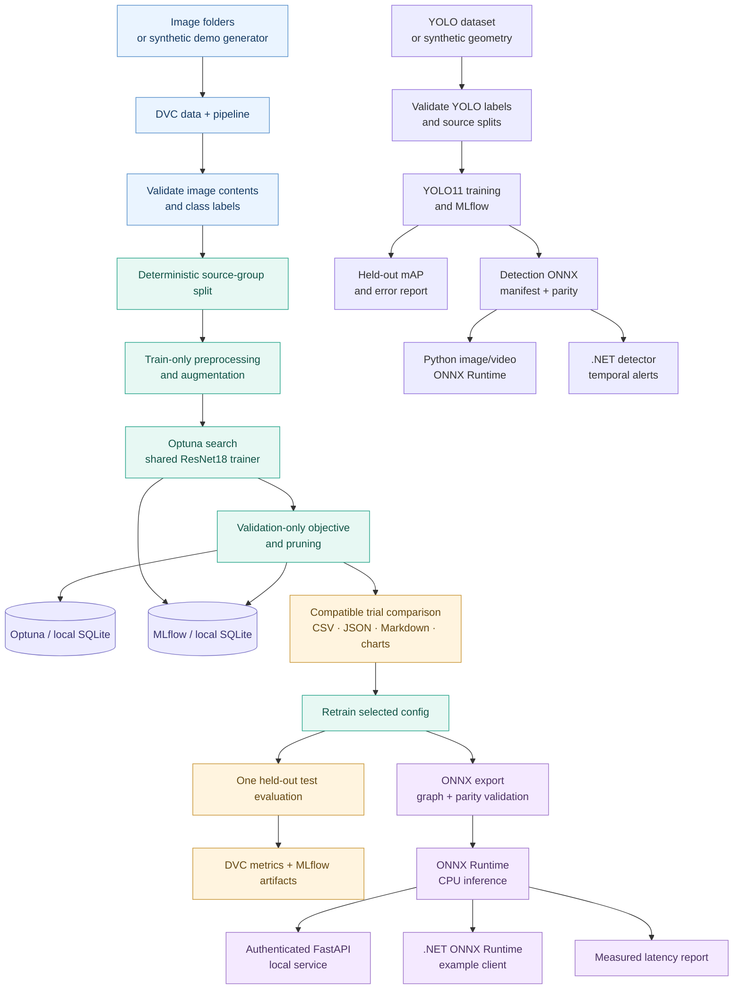

# Surveillance AI Training Lab

**Reproducible computer vision training, evaluation, and experiment tracking — built with Python, PyTorch, TorchVision, and MLflow.**

[](https://www.python.org/)
[](https://pytorch.org/)
[](https://mlflow.org/)
[](#implementation-status)
[](LICENSE)

> **Current scope:** Phases 1–4 provide image classification, MLOps, ONNX serving, and a separate YOLO object-detection pipeline. Detection demos use synthetic geometric fixtures, not weapon imagery; they do not establish real-world performance or production readiness.

## Why this project?

This independent, open-source lab explores the engineering lifecycle of computer-vision models: validated data, source-aware splits, transfer learning, object detection, measured evaluation, reproducible configuration, local experiment tracking, and CPU inference. Optional LLM-assisted experiment reviews remain planned.

## How it works

The diagram distinguishes the implemented classifier path from the independent object-detection path. Later roadmap phases are not included.



**Pipeline in one line:** `Version data → Validate → Tune on validation → Compare compatible trials → Finalize → Evaluate test once → Export and serve`

### What is implemented

| Capability | Status |
| --- | --- |
| Python package and locked dependencies (`uv.lock`) | ✅ |
| Image-folder validation, class reports, source-aware splits | ✅ |
| Seeded synthetic demo scenes | ✅ |
| ResNet18 training, validation, checkpointing, and held-out evaluation | ✅ |
| Local MLflow tracking with SQLite and artifacts | ✅ |
| DVC local-cache dataset/pipeline versioning | ✅ |
| Persistent Optuna tuning with validation-only objective/pruning | ✅ |
| Compatibility-aware comparison reports and charts | ✅ |
| Final retraining and one-time held-out test evaluation | ✅ |
| ONNX export, graph validation, and PyTorch/runtime parity | ✅ |
| Hash-verified ONNX Runtime CPU inference and benchmark report | ✅ |
| Authenticated, upload-limited local FastAPI service | ✅ |
| Standalone .NET ONNX Runtime interoperability example | ✅ |
| Isolated YOLO11 firearm/knife detection pipeline and DVC workflow | ✅ |
| Detection metrics, ONNX contract, Python video inference, and .NET alert DTO | ✅ |
| Docker image and Compose deployment configuration | ✅ |
| Pytest, Ruff, Mypy and CI configuration | ✅ |
| LangGraph and Langfuse | **Planned — not implemented** |

## Quick start

**Requirements:** Python `>=3.12,<3.15` and [uv](https://docs.astral.sh/uv/). The checked-in `uv.lock` pins the resolved dependency graph.

```bash
# Install the project and development tools
uv sync --extra dev

# Generate data, validate it, train with DVC, and evaluate the held-out test split
uv run dvc repro

# Run/resume a two-trial offline Optuna study using the generated data
uv run python scripts/optimize_classifier.py --config configs/optimization_demo.yaml --no-pretrained

# Retrain the best validation-selected parameters and evaluate test once
uv run python scripts/finalize_classifier.py --config configs/optimization_demo.yaml

# Explore training metrics and artifacts in MLflow
uv run mlflow ui --backend-store-uri sqlite:///mlflow.db --host 127.0.0.1 --port 5000
```

Open **http://127.0.0.1:5000**. DVC outputs, Optuna studies, MLflow databases, and model artifacts are local and intentionally not tracked in Git. See [DVC](docs/dvc.md), [optimization](docs/hyperparameter_optimization.md), and [comparison reports](docs/experiment_comparison.md) for reproduction and outputs.

### Object detection (Phase 4)

The separate YOLO pipeline has a synthetic CPU demonstration and a user-data configuration. Its DVC workflow is opt-in and does not change the default classifier workflow. Follow [Object detection](docs/detection.md) for commands, data requirements, licensing, measured demo results, and limitations.

### Transfer learning with pretrained weights

To use TorchVision's public ImageNet-pretrained ResNet18 weights, **omit** `--no-pretrained`:

```bash
uv run python scripts/train_classifier.py --config configs/classification.yaml
```

The initial run may download public model weights. For meaningful evaluation, replace the synthetic demo with a **properly sourced and labeled real dataset** before interpreting model performance. The default `configs/classification.yaml` uses synthetic-demo settings (64-pixel images and 5 epochs) so it should not be presented as a production training recipe.

## Dataset layout

Organize images under the configured dataset root:

```text
data/my_dataset/
├── empty_scene/
├── single_person/
└── multiple_people/
```

Supported formats: `.jpg`, `.jpeg`, `.png`, `.bmp`, and `.webp`.

Place images or video frames from the same source in a nested directory under each class to keep related frames together during the split. Images directly in a class directory are treated as independent sources. The loader verifies image contents and rejects missing classes, invalid files, and corrupt images. At least three source groups per class are required for the three-way split.

**Data protection:** Do not commit private footage, datasets without appropriate usage rights, personal information, generated checkpoints, or MLflow databases.

## Training and evaluation

Edit [`configs/classification.yaml`](configs/classification.yaml) to configure:

- Dataset path, image size, split fractions, imbalance threshold, and random seed.
- ResNet18 initialization and fine-tuning strategy: `head`, `partial`, or `full`.
- Batch size, learning rate, optimizer, weight decay, and number of epochs.
- Scheduler, early-stopping patience, CUDA mixed precision, and MLflow settings.

The model uses ImageNet normalization; augmentation is applied **only** during training. Each epoch evaluates a validation split. The best checkpoint is selected by **validation loss**, and the final selected model is evaluated on a held-out test split.

MLflow stores configuration, data-distribution information, per-epoch training and validation metrics, test metrics, elapsed time, checkpoint, and evaluation reports. It runs locally with a SQLite backend by default; `MLFLOW_TRACKING_URI` can override the tracking URI.

See [Training and evaluation](docs/training.md) and the [Model card](docs/model_card.md).

## ONNX inference

Export and verify an ONNX bundle, then run ONNX Runtime, the local API, benchmark, or
standalone .NET client. The API is authenticated and bound to loopback by default.
See [ONNX export and inference](docs/deployment.md) for commands, security limits,
Docker Compose, and the .NET parity smoke check.

## Quality checks

```bash
uv run pytest -q
uv run ruff check .
uv run mypy src
uv lock --check
```

The included CI workflow validates code quality and focused tests without requiring a GPU or a full training run.

## Project layout

```text
configs/              Training and optimization configuration
docs/                 Training, MLOps, deployment, and model-card documentation
pipelines/detection/  Opt-in YOLO detection DVC pipeline
scripts/              Dataset, training, evaluation, and reporting entry points
src/surveillance_ml/  Dataset, training, optimization, deployment, and inference modules
tests/                Automated tests
dotnet/               .NET classifier and object-detection ONNX clients
.dvc/                 Local DVC configuration and cache ignore rules
.github/workflows/    CI configuration
pyproject.toml         Package and tooling configuration
uv.lock                Locked dependencies
dvc.yaml / dvc.lock    Reproducible dataset and training pipeline
```

## Roadmap

The table distinguishes implemented phases from future work:

| Phase | Planned scope |
| --- | --- |
| **1 — Training foundation** | **Implemented:** ResNet18, dataset validation, splitting, evaluation, MLflow |
| **2 — MLOps** | **Implemented:** DVC pipeline, Optuna tuning, compatibility-aware experiment comparison |
| **3 — Model serving** | **Implemented:** ONNX export and parity checks, ONNX Runtime, FastAPI, benchmarks, Docker, .NET example |
| **4 — Object detection** | **Implemented:** YOLO11 fine-tuning, validated YOLO data, mAP evaluation, separate ONNX inference, video benchmarking, and .NET temporal confirmation |
| **5 — AI workflows** | Optional LangGraph experiment-review graph and Langfuse tracing |
| **6 — Publication** | Broader validation and deployment documentation |

The ONNX bundle supports independent inference clients, including C#/.NET applications. The existing [SurveillanceAI](https://github.com/wilsonsantaluz/SurveillanceAI) project is separate and is not modified or bundled here.

## Responsible use and limitations

- Synthetic colored silhouettes are **pipeline fixtures**, not representative surveillance imagery.
- The firearm and knife labels in the detection demo refer to colored geometric shapes, not depictions of weapons; the measured demo achieved zero precision, recall, and mAP on its tiny held-out synthetic split.
- Small synthetic test splits do not provide trustworthy estimates of real-world performance.
- Neither model identifies individuals or understands intent. The detection pipeline has not been validated on real surveillance or weapon imagery.
- Models require appropriately licensed data, independent validation, and assessment of privacy, bias, and failure modes before any deployment.
- Video and camera inputs may contain sensitive personal data. Use only with appropriate authorization, safeguards, retention limits, and applicable privacy-law review.
- This repository is an independent educational/engineering project and does not contain employer data or proprietary components.

## License

See [LICENSE](LICENSE) for the repository's license. Model-weight and dataset licenses must be reviewed separately.
