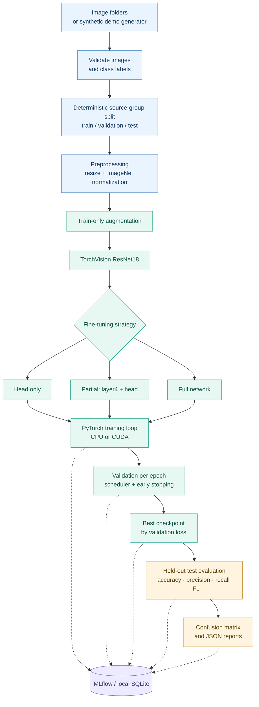

# Surveillance AI Training Lab

**Reproducible computer vision training, evaluation, and experiment tracking — built with Python, PyTorch, TorchVision, and MLflow.**

[](https://www.python.org/)
[](https://pytorch.org/)
[](https://mlflow.org/)
[](#implementation-status)
[](LICENSE)

> **Current scope:** Phase 1 is a working, configurable image-classification training pipeline. It is **not** an object detector or production surveillance system. The generated demo images are synthetic and cannot establish real-world accuracy.

## Why this project?

This independent, open-source lab explores the full engineering lifecycle of a computer-vision model: validated data, source-aware splits, transfer learning, measured evaluation, reproducible configuration, and local experiment tracking. Future phases are planned to explore MLOps, deployment, object detection, and optional LLM-assisted experiment reviews.

## How it works

The diagram below reflects the **implemented Phase 1**, not the future roadmap.



**Pipeline in one line:** `Data → Validate → Split → Augment → Fine-tune → Evaluate → Track`

### What is implemented

| Capability | Phase 1 |
| --- | --- |
| Python package and locked dependencies (`uv.lock`) | ✅ |
| Image-folder dataset validation and class distribution checks | ✅ |
| Locally generated synthetic demo scenes | ✅ |
| Deterministic, source-group-aware train/validation/test splits | ✅ |
| Train-only image augmentation | ✅ |
| ResNet18 transfer learning: head / partial / full | ✅ |
| CPU / CUDA selection and CUDA-only mixed precision | ✅ |
| Learning-rate scheduler, early stopping, best checkpoint | ✅ |
| Held-out test metrics and confusion matrix | ✅ |
| Local MLflow tracking with SQLite and artifacts | ✅ |
| Pytest, Ruff, Mypy and CI configuration | ✅ |
| DVC, Optuna, YOLO, ONNX, FastAPI, LangGraph, Langfuse | **Planned — not implemented** |

## Quick start

**Requirements:** Python `>=3.12,<3.15` and [uv](https://docs.astral.sh/uv/). The checked-in `uv.lock` pins the resolved dependency graph.

```bash
# Install the project and development tools
uv sync --extra dev

# Generate locally labeled synthetic scenes (development only)
uv run python scripts/generate_demo_dataset.py --output-dir data/demo --samples-per-class 24

# Run a completely offline demo with randomly initialized ResNet18
uv run python scripts/train_classifier.py --config configs/classification.yaml --no-pretrained

# Explore training metrics and artifacts in MLflow
uv run mlflow ui --backend-store-uri sqlite:///mlflow.db --host 127.0.0.1 --port 5000
```

Open **http://127.0.0.1:5000**. The training pipeline saves its best checkpoint under `artifacts/classifier/best.pt` and writes evaluation artifacts under `artifacts/`. These local outputs are intentionally not tracked in Git.

### Transfer learning with pretrained weights

To use TorchVision's public ImageNet-pretrained ResNet18 weights, **omit** `--no-pretrained`:

```bash
uv run python scripts/train_classifier.py --config configs/classification.yaml
```

The initial run may download public model weights. For meaningful evaluation, replace the synthetic demo with a **properly sourced and labeled real dataset** before interpreting model performance. The default `configs/classification.yaml` uses synthetic-demo settings (64-pixel images and 5 epochs) so it should not be presented as a production training recipe.

## Dataset layout

Organize images under the configured dataset root:

```text
data/my_dataset/
├── empty_scene/
├── single_person/
└── multiple_people/
```

Supported formats: `.jpg`, `.jpeg`, `.png`, `.bmp`, and `.webp`.

Place images or video frames from the same source in a nested directory under each class to keep related frames together during the split. Images directly in a class directory are treated as independent sources. The loader verifies image contents and rejects missing classes, invalid files, and corrupt images. At least three source groups per class are required for the three-way split.

**Data protection:** Do not commit private footage, datasets without appropriate usage rights, personal information, generated checkpoints, or MLflow databases.

## Training and evaluation

Edit [`configs/classification.yaml`](configs/classification.yaml) to configure:

- Dataset path, image size, split fractions, imbalance threshold, and random seed.
- ResNet18 initialization and fine-tuning strategy: `head`, `partial`, or `full`.
- Batch size, learning rate, optimizer, weight decay, and number of epochs.
- Scheduler, early-stopping patience, CUDA mixed precision, and MLflow settings.

The model uses ImageNet normalization; augmentation is applied **only** during training. Each epoch evaluates a validation split. The best checkpoint is selected by **validation loss**, and the final selected model is evaluated on a held-out test split.

MLflow stores configuration, data-distribution information, per-epoch training and validation metrics, test metrics, elapsed time, checkpoint, and evaluation reports. It runs locally with a SQLite backend by default; `MLFLOW_TRACKING_URI` can override the tracking URI.

See [Training and evaluation](docs/training.md) and the [Model card](docs/model_card.md).

## Quality checks

```bash
uv run pytest -q
uv run ruff check .
uv run mypy src
uv lock --check
```

The Phase 1 implementation was reported as passing 11 focused tests, Ruff, Mypy, and the lockfile check. Run these commands in your own environment to verify the current revision. The included CI workflow validates project quality without a full GPU training run.

## Project layout

```text
configs/            Training configuration
docs/               Training documentation and model card
scripts/            Synthetic data generation and training entry points
src/surveillance_ml/  Dataset, model, training, metrics and tracking modules
tests/              Automated tests
.github/workflows/   CI configuration
pyproject.toml       Package and tooling configuration
uv.lock              Locked dependencies
```

## Roadmap

The following phases are **planned**, not part of the current implementation:

| Phase | Planned scope |
| --- | --- |
| **1 — Training foundation** | **Implemented:** ResNet18, dataset validation, splitting, evaluation, MLflow |
| **2 — MLOps** | DVC data/pipeline versioning, Optuna tuning, experiment comparison |
| **3 — Model serving** | ONNX export and parity checks, ONNX Runtime, FastAPI inference |
| **4 — Object detection** | YOLO fine-tuning, bounding boxes, mAP evaluation |
| **5 — AI workflows** | Optional LangGraph experiment-review graph and Langfuse tracing |
| **6 — Publication** | Extended benchmarks, documentation, deployment examples, optional .NET interoperability |

The eventual ONNX export is intended to enable independent inference clients, including C#/.NET applications. The existing [SurveillanceAI](https://github.com/wilsonsantaluz/SurveillanceAI) project is separate and is not modified or bundled here.

## Responsible use and limitations

- Synthetic colored silhouettes are **pipeline fixtures**, not representative surveillance imagery.
- Small synthetic test splits do not provide trustworthy estimates of real-world performance.
- Scene classification does **not** detect bounding boxes, track people, identify individuals, or understand intent.
- Models require appropriately licensed data, independent validation, and assessment of privacy, bias, and failure modes before any deployment.
- This repository is an independent educational/engineering project and does not contain employer data or proprietary components.

## License

See [LICENSE](LICENSE) for the repository's license. Model-weight and dataset licenses must be reviewed separately.
